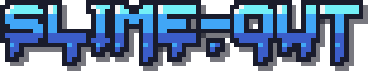
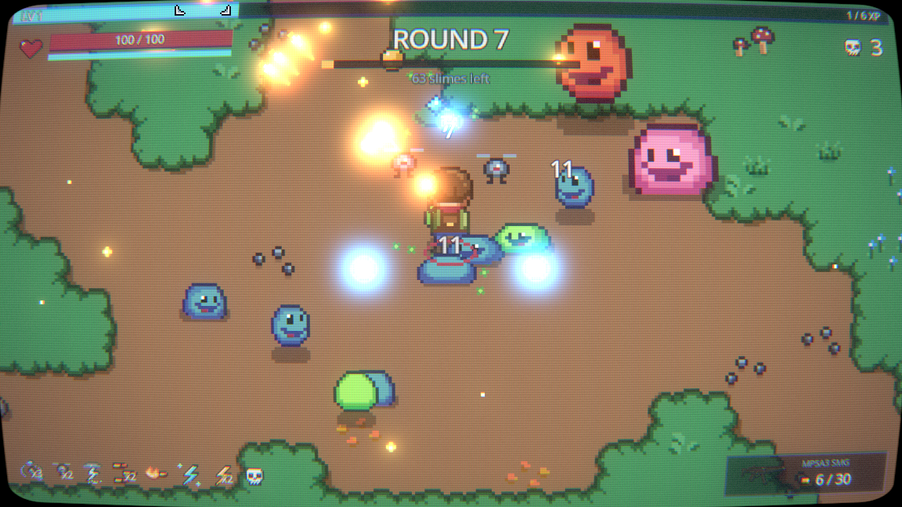
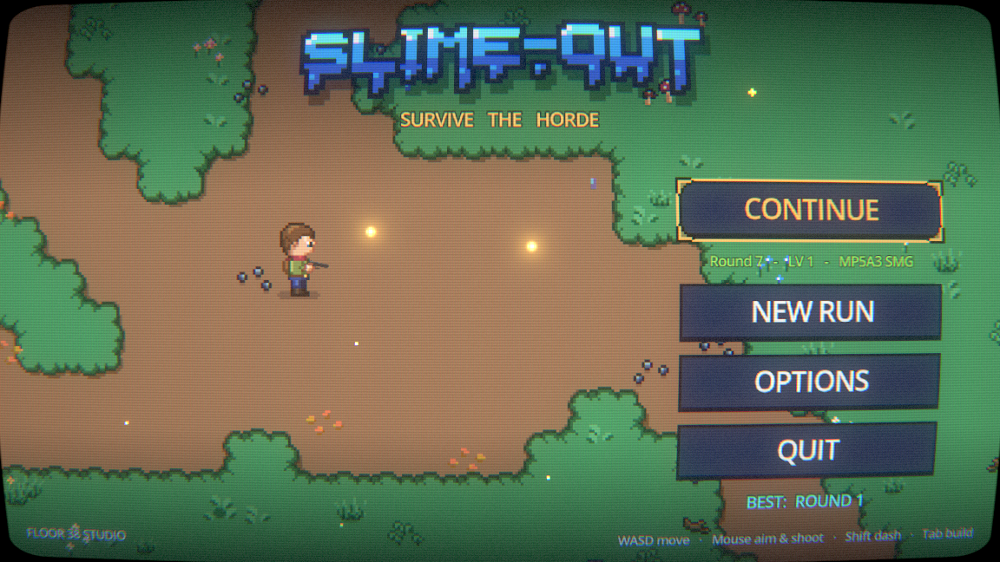
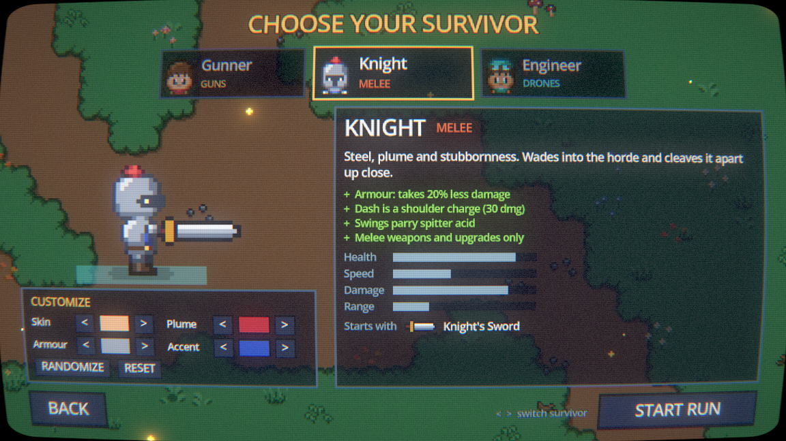
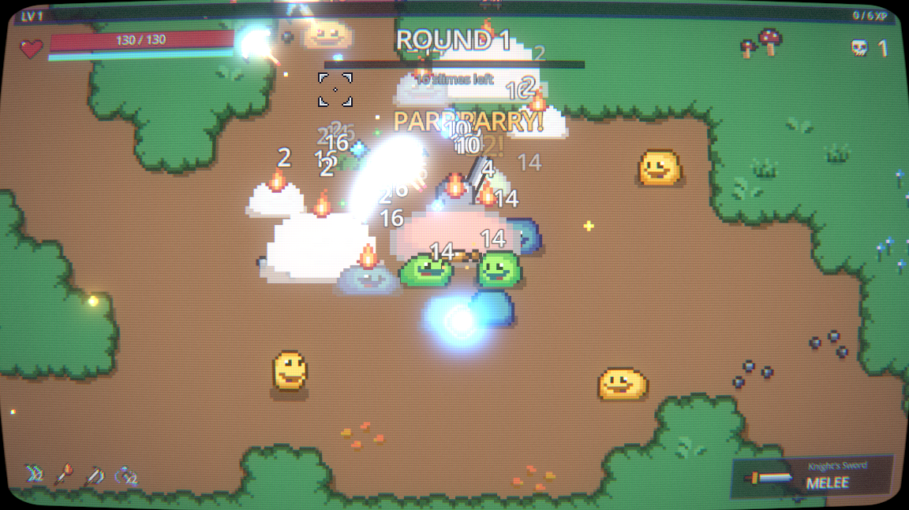
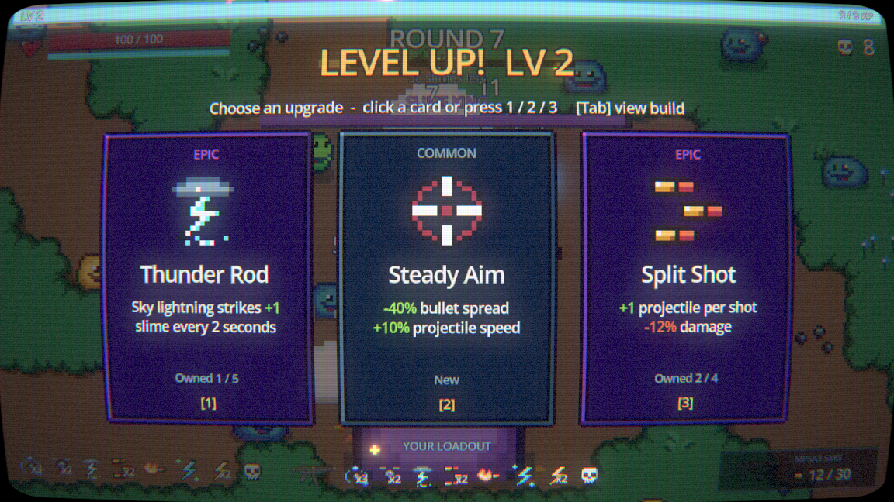
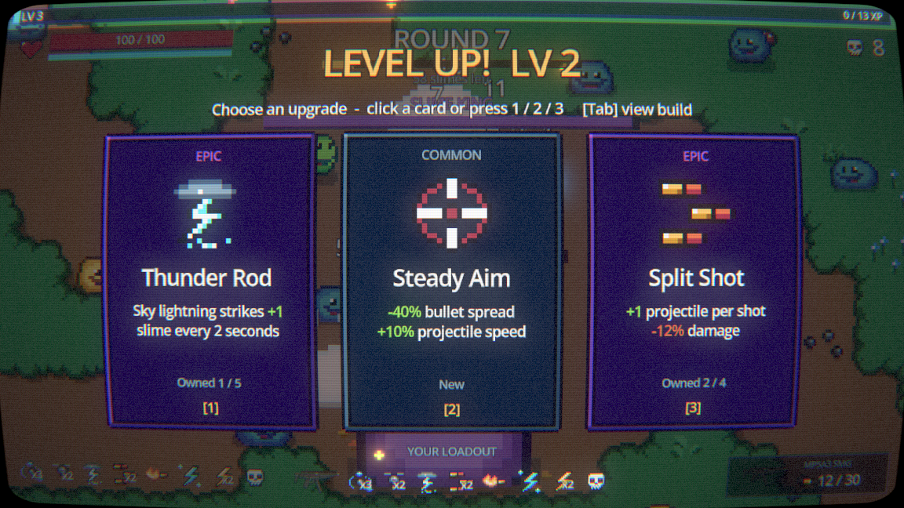
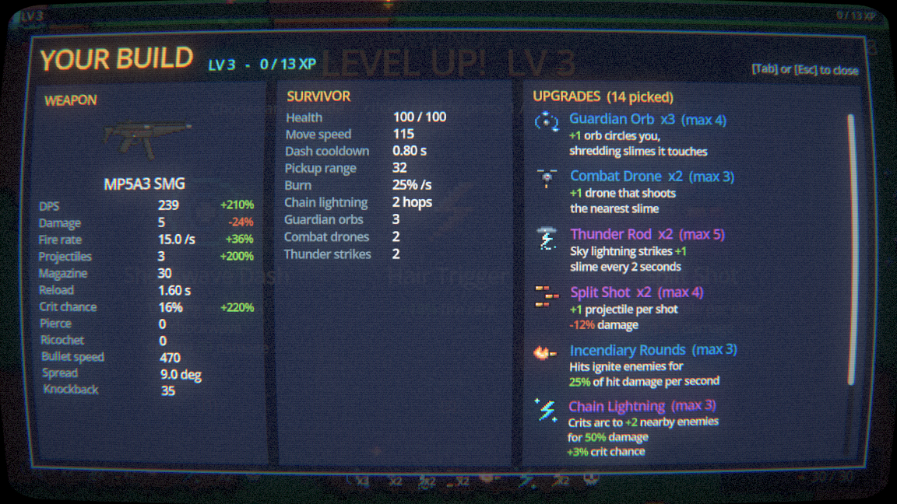
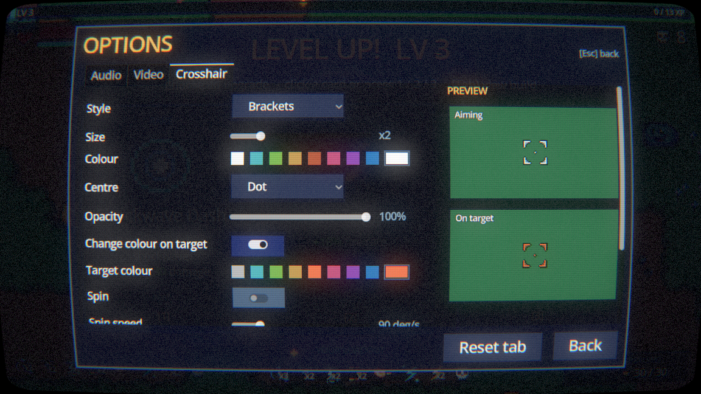

<div align="center">



### Survive the horde.

A pixel-art, round-based **horde-survival shooter** with roguelite upgrades —<br>
part *Vampire Survivors*, part *Enter the Gungeon*, all slime.




</div>

---

## Table of contents
- [About](#about)
- [Features](#features)
- [Screenshots](#screenshots)
- [Survivors](#survivors)
- [The arsenal](#the-arsenal)
- [The horde](#the-horde)
- [Upgrades](#upgrades)
- [Controls](#controls)
- [Getting started](#getting-started)
- [Saves & settings](#saves--settings)
- [Project structure](#project-structure)
- [Content pipeline](#content-pipeline)
- [Credits](#credits)
- [License](#license)

## About

**Slime-Out** drops you into a fenced clearing deep in the forest with a bad feeling and one of three survivors: the **Gunner**, the sword-swinging **Knight** or the drone-commanding **Engineer**. Slimes pour out of the trees in ever-larger waves. Clear a round, pick one of three upgrades, and go again. Every round is harder than the last, and every fifth round the **Slime King** comes to collect.

Upgrades never go to waste: they are stored as weapon-agnostic modifiers, so when you swap your pistol for an AK-47 or your sword for a war hammer, **every upgrade you own carries over** to the new weapon.

## Features

**Core loop**
- **Three playable survivors** with their own weapons, upgrade pools and traits — guns, melee or drones — picked on a dedicated **character select** screen.
- **Customize every survivor's look** (skin, hair / plume, outfit / armour, accent) with hand-picked palettes; looks are remembered per character.
- Endless, escalating rounds — enemy count, health, speed and damage all scale per round, with spawn bursts that grow every three rounds.
- **Boss rounds** every 5 rounds featuring the crowned Slime King.
- **Pick 1 of 3 upgrades** after every round, weighted by rarity (Common / Rare / Epic), with weapon swaps offered on round-end picks.
- **XP gems & mid-round level-ups** — slimes drop gems that magnetise to you; level up mid-fight for an instant pick.
- **Auto-weapons** in the bullet-heaven tradition: guardian orbs, combat drones and sky lightning fight alongside you.
- **Dash with i-frames** — dash straight through the horde (with a short grace window and a satisfying *DODGE!*).
- **Melee combat** for the Knight: alternating arcing swings, glowing slash arcs, cleave hits, shockwave hammers, flying sword waves and **acid parries**.

**Feel & visuals**
- Hand-made pixel art: hero, slimes, FX and UI drawn in Aseprite, plus a forest arena built from the Mystic Woods tileset.
- **Hand-animated survivors**: 8-frame runs with overlapping action (the head trails the body), forward lean, flapping scarves and capes, swaying plumes, plus dedicated dash, hurt and 6-frame death animations.
- **Squash & stretch** on every step, dash, hit and turn, with footstep dust and footstep sounds.
- **Juice everywhere** (the Vlambeer recipe): muzzle flares, ejected brass casings, recoil, camera kick, smooth noise-based screen shake, hit-stop, damage numbers, goo splats that stay on the floor.
- **HDR bloom** on bullets, explosions, orbs, lightning and gems.
- **CRT post-processing** — curved glass, scanlines, aperture grille, chromatic aberration and vignette (adjustable or off).
- Living arena: wind-swayed foliage, drifting fireflies, flowers, mushrooms and winding dirt paths.

**Audio**
- Layered gunshots designed per weapon (mechanical click → crack → body → sub → outdoor tail), realistic reload foley and bouncing brass casings.
- Original 150 BPM gameplay track **"Slime Rush"**; a separate theme plays on the menus and pause screen.
- Positional sound, voice limiting for huge fights, and a rising pitch chain when vacuuming up gems.

**Quality of life**
- **Animated main menu** in "attract mode" — the hero holds the clearing behind a dripping, bouncing logo.
- **Continue your run**: quit mid-round and pick up exactly where you left off (enemies, pickups and all).
- **Build inspector** (`Tab`) showing every stat with your upgrades applied and everything you've picked.
- **Options menu** for audio buses, video, screen shake, hit-stop, damage numbers and a fully **custom crosshair** (5 styles, size, colours, spin, recoil kick, hit markers) with a live preview.

## Screenshots

| | |
|:---:|:---:|
|  |  |
| **Attract-mode main menu** | **Choose and customize your survivor** |
|  |  |
| **The Knight cleaving through a crowd** | **The Slime King arrives** |
|  |  |
| **Level up — pick one of three** | **Build inspector** |
|  |  |
| **Custom crosshair with live preview** | **Orbs, drones and incendiary rounds** |

## Survivors

| Survivor | Style | Health | Trait |
|---|---|---:|---|
| **Gunner** | Guns | 100 | +5% crit, reloads 15% faster, can find all 6 guns |
| **Knight** | Melee | 130 | 20% armour, dash is a 30-damage shoulder charge, swings parry spitter acid, melee-only weapons and upgrades |
| **Engineer** | Drones | 90 | Starts with 2 combat drones that hit 20% harder, −15% gun damage, exclusive drone upgrades |

Each survivor has four recolourable palette slots (skin, hair/plume, outfit/armour, accent). Pick colours on the select screen; they're saved per survivor and carried into saved runs.

## The arsenal

Each survivor starts with their signature weapon. Others appear as upgrade choices once you reach their unlock round, and your upgrades always transfer.

### Guns (Gunner, Engineer)

| Weapon | Damage | Fire rate | Magazine | Reload | Special | Unlocks |
|---|---:|---:|---:|---:|---|:---:|
| **Glock P80** | 10 | 4 / s | 12 | 1.1 s | Reliable starter | Start |
| **Colt 45 Revolver** | 30 | 2 / s | 6 | 1.7 s | Pierces 1 enemy | Round 2 |
| **MP5A3 SMG** | 7 | 11 / s | 30 | 1.6 s | Bullet hose, loose spread | Round 2 |
| **AK-47** | 13 | 8 / s | 30 | 2.1 s | Pierces 1 enemy | Round 4 |
| **M20 Bazooka** | 40 | 1.1 / s | 3 | 2.4 s | Explosive rockets | Round 5 |
| **M20 Heavy Launcher** | 75 | 0.8 / s | 2 | 2.8 s | Huge blast radius | Round 8 |

### Melee (Knight)

| Weapon | Damage | Swings | Reach | Arc | Special | Unlocks |
|---|---:|---:|---:|---:|---|:---:|
| **Knight's Sword** | 16 | 2.6 / s | 30 | 120° | Quick, wide swings | Start |
| **Spear** | 15 | 2.2 / s | 46 | 50° | Long, narrow thrusts | Round 2 |
| **Battle Axe** | 34 | 1.3 / s | 34 | 170° | Cleaves everything around you | Round 3 |
| **War Hammer** | 42 | 0.9 / s | 30 | 110° | Every blow releases a shockwave | Round 5 |

## The horde

| Slime | Behaviour | Health | First seen |
|---|---|---:|:---:|
| **Slime** | Chases you down | 30 | Round 1 |
| **Swift Slime** | Fast and fragile | 18 | Round 3 |
| **Brute Slime** | Big, slow, hits hard | 140 | Round 4 |
| **Spitter Slime** | Keeps its distance and lobs acid that leads your movement | 22 | Round 5 |
| **Splitter Slime** | Bursts into fast Splitlings on death | 80 | Round 6 |
| **Charger Slime** | Telegraphs with a **!**, then dashes in a straight line | 45 | Round 7 |
| 👑 **Slime King** | Boss — arrives halfway through every 5th round | 650 | Round 5 |

Health values are base values; every round multiplies enemy health, speed and damage.

## Upgrades

40 upgrades across three rarities. Most stack; some have a cap. Each survivor only sees the cards that fit their style (**All**, **Guns**, **Melee** or **Engineer**).

<details>
<summary><b>Show all upgrades</b></summary>

| Upgrade | For | Rarity | Effect | Max |
|---|---|---|---|:---:|
| Hollow Points | Guns | Common | +20% damage | ∞ |
| Hair Trigger | Guns | Common | +18% fire rate | ∞ |
| Extended Mag | Guns | Common | +35% magazine size | ∞ |
| Speed Loader | Guns | Common | −20% reload time | ∞ |
| High Velocity | Guns | Common | +30% projectile speed, +8% damage | ∞ |
| Vitality | All | Common | +25 max health, heals 25 | ∞ |
| Heavy Rounds | Guns | Common | +60% knockback, +6% damage | 3 |
| Steady Aim | Guns | Common | −40% bullet spread, +10% projectile speed | 3 |
| Thorns | All | Common | When hit, blast nearby enemies for 30 damage | 3 |
| Adrenaline | All | Common | −25% dash cooldown | 3 |
| Magnet | All | Common | +50% pickup radius | 4 |
| Light Boots | All | Common | +12% move speed | 5 |
| Field Medic | All | Rare | Fully heal, +10 max health | ∞ |
| Bloodthirst | All | Rare | Heal 1 HP per kill | 3 |
| Incendiary Rounds | Guns | Rare | Hits ignite enemies for 25% of hit damage per second | 3 |
| Ricochet | Guns | Rare | Bullets bounce to +1 nearby enemy after their last hit | 3 |
| Shockwave Dash | All | Rare | Dashing ends in a 30-damage shockwave | 3 |
| Combat Drone | All | Rare | +1 drone that shoots the nearest slime | 3 |
| AP Rounds | Guns | Rare | Shots pierce +1 more enemy | 4 |
| Big Boom | Guns | Rare | +35% explosion radius, +10% damage | 4 |
| Guardian Orb | All | Rare | +1 orb circles you, shredding slimes it touches | 4 |
| Deadeye | All | Rare | +8% crit chance (crits deal 2× damage) | 6 |
| Last Stand | All | Epic | Below 30% health: +50% damage and fire rate | 1 |
| Second Chance | All | Epic | Once per run, revive at 50% health | 1 |
| Glass Cannon | All | Epic | +40% damage, −20 max health | 2 |
| Chain Lightning | All | Epic | Crits arc to +2 nearby enemies for 50% damage, +3% crit | 3 |
| Split Shot | Guns | Epic | +1 projectile per shot, −12% damage | 4 |
| Thunder Rod | All | Epic | Sky lightning strikes +1 slime every 2 seconds | 5 |
| Iron Skin | All | Rare | Take 8% less damage | 3 |
| Whetstone | Melee | Common | +22% melee damage | ∞ |
| Swift Strikes | Melee | Common | +18% attack speed | ∞ |
| Long Reach | Melee | Common | +18% melee reach | 4 |
| Heavy Blows | Melee | Common | +60% knockback, +6% damage | 3 |
| Wide Arc | Melee | Rare | +25% swing arc | 3 |
| Vampiric Edge | Melee | Rare | Heal 5% of melee damage dealt | 3 |
| Flame Edge | Melee | Rare | Hits ignite slimes for 25% of hit damage per second | 3 |
| Sword Wave | Melee | Epic | Every swing releases +1 flying slash | 3 |
| Overclock | Engineer | Rare | Drones fire 30% faster | 4 |
| Heavy Payload | Engineer | Rare | +35% drone damage | 4 |
| Drone Bay | Engineer | Epic | +1 combat drone | 4 |

</details>

## Controls

| Action | Keyboard & mouse |
|---|---|
| Move | `W` `A` `S` `D` |
| Aim | Mouse |
| Shoot / swing | Left mouse button (hold) |
| Reload | `R` |
| Dash | `Shift` |
| Build inspector | `Tab` or `I` |
| Pick upgrade | Click a card or press `1` / `2` / `3` |
| Pause | `Esc` |
| Switch survivor (select screen) | `A` / `D` or arrow keys |

Movement also works with a gamepad's D-pad and left stick.

## Getting started

### Requirements
- [Godot Engine **4.7**](https://godotengine.org/download) (standard build — no C#/.NET needed)
- A GPU with Direct3D 12 or Vulkan support (Forward+ renderer)

### Run from source
```bash
git clone https://github.com/AmitShok/Slime-Out.git
```
1. Open Godot 4.7 and **Import** the cloned folder's `project.godot`.
2. Let the first import finish (it generates the `.godot/` cache).
3. Press **F5** to play — the game starts on the main menu.

### Build a standalone game
1. In Godot, open **Editor → Manage Export Templates** and install the 4.7 templates.
2. **Project → Export → Add… → Windows Desktop**, then **Export Project**.

## Saves & settings

Everything is stored in Godot's user folder — on Windows:
`%APPDATA%\Godot\app_userdata\Slime-Out\`

| File | Contents |
|---|---|
| `run.json` | The in-progress run (autosaved every 10 s, at round milestones, after each pick and on quit). Deleted when the run ends. |
| `save.cfg` | Records — best round reached. |
| `settings.cfg` | Audio, video and crosshair options. |
| `profile.cfg` | Last picked survivor and each survivor's custom look. |

Dying ends a run for good — it's a roguelite.

## Project structure

```
├── scenes/            Game, main menu, player, enemy, weapon, UI and arena scenes
├── scripts/
│   ├── autoload/      Events bus, Settings, Sound director, SceneFader
│   ├── data/          Resource classes: CharacterData, WeaponData, UpgradeData, EnemyData, Stats
│   ├── fx/            Debris, decals, shockwaves, lightning, damage numbers
│   ├── ui/            HUD, menus, upgrade cards, build inspector, crosshair
│   ├── game.gd        Round loop, level-ups, character setup and run save/restore
│   ├── character_looks.gd  Palette slots + pixel-exact recolouring
│   ├── profile.gd     Selected survivor and saved looks
│   ├── wave_manager.gd  Spawning and difficulty scaling (all tunable in the inspector)
│   └── player_stats.gd  Weapon-agnostic upgrade stacking
├── resources/         Character, weapon, enemy and upgrade definitions (.tres), themes, tilesets
├── shaders/           CRT, iris wipe, wind sway, hit flash, screen overlay
├── assets/            Sprites, tiles, audio (third-party packs + floor38/ originals)
├── art_src/           Aseprite sources and the generator scripts below
└── docs/              README images
```

**Design notes**
- Upgrades are data: each `UpgradeData` holds `StatModifier`s (flat or percent). Final stat = `(base + Σflat) × (1 + Σpercent)`, so swapping weapons just changes the base. Survivors add their own base stats and trait modifiers on top, and `UpgradeData.styles` decides who can be offered a card.
- Gameplay systems talk through the `Events` autoload (screen shake, hits, kills, bosses) instead of hard references.
- Big hordes stay fast with a spatial hash for enemy separation and caps on decals, casings and damage numbers.

## Content pipeline

Original art and audio are generated from source scripts so they can be tweaked and rebuilt:

| Script | Produces |
|---|---|
| `art_src/tools/build_player.lua` | Gunner, Knight and Engineer sprite sheets + hands |
| `art_src/tools/build_melee.lua` | Melee weapons, slash arc, sword wave, survivor upgrade icons |
| `art_src/tools/build_fx_enemies.lua`, `build_fx_small.lua`, `build_juice.lua` | Slime variants, explosions, sparks, gems, pickups, orbs, drones |
| `art_src/tools/build_ui_icons.lua`, `build_reticle.lua`, `build_logo.lua` | Upgrade icons, crosshair parts, title logo |
| `art_src/tools/build_arena.lua` | Arena decorations and fireflies |
| `art_src/tools/build_arena_scenes.gd` | Bakes the arena scenes (tiles, forest, fence, obstacles) |
| `art_src/tools/build_sfx.gd` | Gunshots, reloads, casings, drone shots |
| `art_src/tools/build_music.gd` | The "Slime Rush" gameplay track |

```bash
# Aseprite art (run from the project folder)
Aseprite.exe -b --script-param root=<project path> --script art_src/tools/build_logo.lua
# Godot generators
godot --headless --path . --script art_src/tools/build_sfx.gd
```

## Credits

**Slime-Out** is made by **Floor 38 Studio** — game design, code, original pixel art, sound design and music.

Third-party assets:
- **Mystic Woods** tileset, trees and slime base sprites — by [Game Endeavor](https://game-endeavor.itch.io/mystic-woods)
- **Guns V1.01** weapon sprites and animations
- **Ninja Adventure Asset Pack** sound effects, jingles, ambience and menu music — by [Pixel-boy & AAA](https://pixel-boy.itch.io/ninja-adventure-asset-pack) (CC0)
- **160+ Cursors Crosshairs Pack**
- **Agent Mike** bullet UI icon
- Built with the [Godot Engine](https://godotengine.org)

Design inspiration: *Vampire Survivors*, *Enter the Gungeon*, *Nuclear Throne* and *Brotato*.

## License

No open-source license has been chosen yet, so all rights to the original code and art are reserved by **Floor 38 Studio**. Third-party assets remain under their respective creators' licenses.
